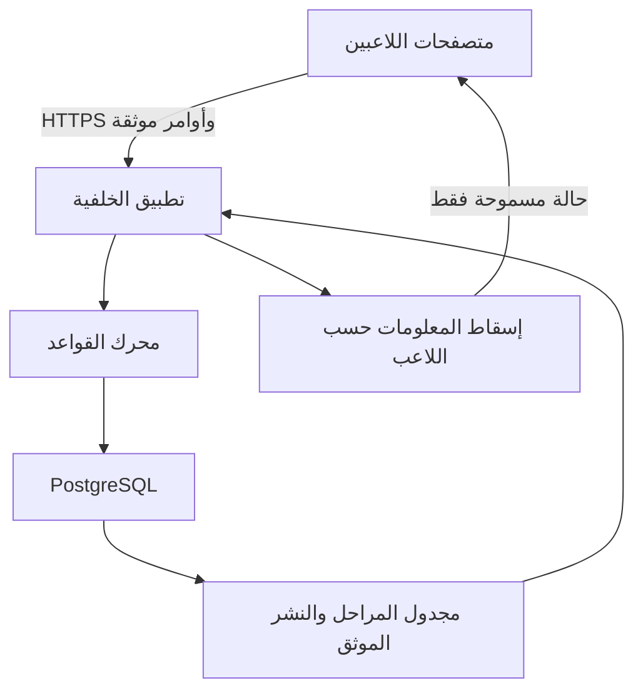
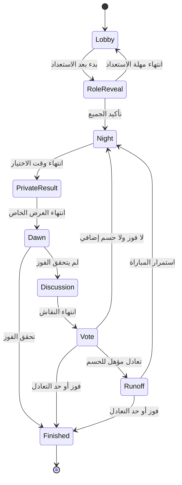

# مافيا — قواعد النسخة الأولى وتصميم النظام وخطة التنفيذ

التاريخ: 2 نوفمبر 2026  
الحالة: تصميم مقترح للتنفيذ؛ لم تُبنَ اللعبة أو تُختبر بعد.  
الاسم مؤقت. القرارات المؤكدة تخص طريقة اللعب؛ الأعداد والتوقيتات والتقنيات التالية توصيات قابلة للتعديل بالتجربة.

## 1. الهدف والقرارات المؤكدة

لعبة اجتماعية لأصدقاء موجودين في المكان نفسه. يتحدثون وجهًا لوجه، وكل لاعب يستخدم متصفح موبايله لاستقبال دوره وتنفيذ القرارات السرية والتصويت. التطبيق يقوم بدور الراوي والحكم.

المؤكد من المستخدم:

- البداية Web مناسبة للموبايل.
- وجود إنترنت عند جميع اللاعبين مقبول.
- اللعب للموجودين معًا فقط في هذه المرحلة.
- يُكشف دور اللاعب عند خروجه.
- المطلوب استبدال تغميض العين بمرحلة ليل سرية داخل الموبايلات.

المستخدمون: لاعب، وصاحب غرفة يشارك كلاعب، ولاعب خرج يتابع المعلومات العامة. لا يحتاج أي منهم إلى رؤية لوحة إدارة تكشف الأسرار.

## 2. نطاق أول نسخة والافتراضات

| العنصر | المقترح |
| --- | --- |
| حجم الغرفة | 8–12 لاعبًا، جهاز مستقل لكل لاعب |
| اللغة | عربية بواجهة RTL وتعليمات مصرية بسيطة |
| الهوية | اسم داخل الغرفة وصورة رمزية جاهزة، من غير حساب مستخدم |
| الدخول | رابط دعوة أو كود غرفة مع QR |
| الأدوار | مافيا، مواطن، دكتور، محقق |
| الصوت | إعلانات عامة مسجلة من جهاز مختار واحد؛ كل التعليمات متاحة كتابة |
| الاتصال | إنترنت مستمر أثناء اللعب، مع استعادة الجلسة عند الرجوع |
| البداية | غرفة خاصة ومعارف، وليست مطابقة مع غرباء |

خارج النسخة الأولى: اللعب عن بُعد، الدردشة والصوت الجماعي، حسابات دائمة، تصنيف ومواسم ومشتريات، أدوار إضافية، مشاهدة عامة، ألعاب دون إنترنت، وتطبيقات المتاجر. لا توجد حاجة إلى AI للحكم أو توزيع الأدوار؛ القواعد الحتمية أنسب للعدالة والاختبار.

## 3. قواعد اللعبة المقترحة

### توزيع الأدوار

| اللاعبون | مافيا | دكتور | محقق | مواطنون |
| --- | --- | --- | --- | --- |
| 8 | 2 | 1 | 1 | 4 |
| 9 | 2 | 1 | 1 | 5 |
| 10 | 2 | 1 | 1 | 6 |
| 11 | 3 | 1 | 1 | 6 |
| 12 | 3 | 1 | 1 | 7 |

هذا توزيع تجريبي، وليس ادعاءً بأنه متوازن بالفعل. تقاس نتائج جلسات حقيقية قبل تثبيته. التوزيع عشوائي آمن على السيرفر؛ صاحب الغرفة لا يختار الأدوار ولا يعرفها. كل مافيا يعرف زملاءه على شاشته الخاصة.

### البداية

ينشئ صاحب الغرفة غرفة، ويحدد مدة النقاش من خيارات محدودة. يدخل الباقون ويختارون أسماء وصورًا لا تتكرر داخل الغرفة. يطابق الجميع قائمة الأسماء بالأشخاص الموجودين. يسمح صاحب الغرفة بدخولهم، ثم يقفل الانضمام ويبدأ عند اكتمال العدد واستعداد الجميع.

يُكشف الدور بالضغط المستمر، ويختفي عند رفع الإصبع أو خروج الصفحة للخلفية. مدة التعرف على الدور موحدة، 30 ثانية مقترحة، ولا تُعرض قائمة بمن قرأ دوره. لا تبدأ اللعبة قبل تأكيد الاستعداد من الجميع؛ عند انتهاء المهلة يعود الجميع للانتظار بدل كشف مَن يحتاج وقتًا إضافيًا.

تبدأ أول ليلة بعد التعرف على الأدوار. لا يوجد قتل أو تصويت قبل اكتمال توزيع الأدوار.

### الليل دون تغميض العين

- مدة مبدئية ثابتة: 45 ثانية، حتى لو أنهى الجميع اختياراتهم مبكرًا.
- نفس الغلاف البصري، وقائمة الأسماء بترتيب المقاعد نفسه، والعد التنازلي عند الجميع. المحتوى السري داخل منطقة لا تظهر إلا بالضغط المستمر.
- المافيا يختارون ضحية من الأحياء خارج فريقهم. يرون اختيارات زملائهم داخل المنطقة الخاصة فقط، ويستطيعون تعديلها حتى الموعد النهائي.
- يفوز الهدف بأعلى عدد من اختيارات المافيا المقدمة؛ التعادل في الأعلى أو عدم وجود اختيارات يعني عدم تنفيذ هجوم تلك الليلة. لا يحصل صاحب الغرفة على صوت مرجح.
- الدكتور يحمي لاعبًا حيًا، ويمكنه حماية نفسه، ولا يحمي الشخص نفسه ليلتين متتاليتين. عدم الاختيار يعني عدم وجود حماية.
- المحقق يختار لاعبًا حيًا غير نفسه؛ النتيجة «مافيا» أو «ليس مافيا»، من غير تحديد الدور المدني.
- المواطن يختار شخصًا يشك فيه لنفسه. لا يؤثر ذلك على القتل أو التصويت، ولا يُرسل الهدف للسيرفر؛ يُرسل تأكيد مشاركة موحد فقط مثل بقية اللاعبين.
- التصرفات القانونية تُحسم باستخدام حالة بداية الليل. الحماية تلغي الهجوم فقط إذا اتحد الهدفان. لا يوجد كشف لهوية الدكتور أو لسبب النجاة عند الإعلان.
- المحقق يحصل على نتيجة فحصه حتى إذا كان ضحية الليلة نفسها، باعتبار الأفعال متزامنة. بعد إعلان خروجه لا يشارك بالكلام أو التصويت.
- بعد نهاية الاختيار تبدأ شاشة خاصة موحدة لمدة 8 ثوانٍ للجميع: نتيجة للمحقق، ورسالة انتهاء الدور للباقين. بعدها فقط تُعلن نتيجة الفجر وتُكشف هوية الخارج.
- الخارجون لا يُعرض عليهم دور الأحياء ولا اختيارات المافيا؛ يتابعون مؤقتًا وشاشة عامة أثناء الليل.

لا أصوات أو اهتزازات خاصة بدور معين، ولا مؤشرات عامة لمن اختار أو غيّر هدفه، ولا اختلاف في وقت انتهاء الشاشة حسب الدور. لا يمكن ضمان منع نظرات اللاعبين أو تصوير الشاشة بكاميرا أخرى؛ الخصوصية التقنية لا تُلغي الإشارات الاجتماعية.

### النهار والتصويت

- يُعلن الفجر عن الضحية ودورها، أو «لم يخرج أحد الليلة»، من غير تفسير عدم القتل.
- نقاش وجها لوجه: 120 ثانية مبدئيًا. بعده تصويت سري لمدة 30 ثانية.
- كل لاعب حي يختار حيًا آخر أو يمتنع. يمكن تعديل الاختيار حتى نهاية الوقت، ولا يظهر أي اختيار قبل الإغلاق.
- يفوز أعلى مرشح أصواتًا من أصوات اللاعبين، بشرط ألا يتعادل في الأعلى وألا يساويه أو يتجاوزه عدد الممتنعين. عدم التصويت يُحسب امتناعًا.
- عند تعادل مرشحين في أعلى عدد، وكان الامتناع أقل منهم، تجرى جولة حسم واحدة بين المتعادلين لمدة 20 ثانية، مع حق الامتناع ومنع التصويت للنفس.
- إذا تكرر التعادل، أو ساوى الامتناع أعلى مرشح أو تجاوزه، لا يخرج أحد وينتقل اللعب لليل.
- تُعلن أعداد الأصوات والامتناع فقط، وليس اختيار كل لاعب. يُكشف دور المستبعد فورًا.
- لا يشارك الخارج في النقاش أو التصويت؛ الالتزام بالصمت داخل القعدة قاعدة اجتماعية لا يستطيع الموقع فرضها جسديًا.

### الفوز ونهاية المباراة

يفوز المدنيون عندما لا تبقى مافيا حية. تفوز المافيا عندما يصبح عددها الحي مساويًا لعدد بقية الأحياء أو أكبر. يُفحص الفوز بعد إعلان نتيجة الليل وبعد كل استبعاد بالتصويت، ولا يبدأ طور جديد بعد تحقق الفوز.

لمنع جلسة عالقة بسبب الامتناع أو التعادل المستمر: بعد ثلاث دورات كاملة متتالية دون أي خروج تنتهي المباراة بالتعادل، ويظهر هذا الشرط قبل البداية. يُعاد العداد إلى صفر عند أي خروج. هذا حد تشغيلي مقترح يحتاج تجربة، ولا يُغير الفريق الفائز بأثر رجعي.

عند النهاية تُعرض جميع الأدوار وملخص الأحداث العامة. لا تُعرض التحقيقات أو اختيارات الأشخاص الفردية. «العبوا تاني» تنشئ مباراة جديدة بنفس الغرفة، بتوزيع جديد مستقل، بعد استعداد الجميع.

## 4. رحلة المستخدم والشاشات

| الشاشة | أهم محتوى |
| --- | --- |
| البداية | إنشاء غرفة / دخول غرفة / شرح سريع |
| الانضمام | الكود، الاسم، الصورة الرمزية |
| انتظار القبول | حالة طلب الدخول فقط |
| الغرفة | أسماء اللاعبين، الاستعداد، الدعوة، بدء اللعبة لصاحبها |
| شرح القواعد | قواعد الفوز والتعادل والحماية والخصوصية |
| دوري | كشف بالضغط المستمر، ثم إخفاء وتأكيد الاستعداد |
| الليل | المؤقت، الاختيار السري، رسالة قبول عامة موحدة |
| النتيجة الخاصة | نفس الغلاف والتوقيت لجميع اللاعبين |
| الفجر | الخارج ودوره، أو عدم خروج أحد |
| النقاش | الأحياء والمستبعدون ومؤقت واضح |
| التصويت والحسم | اختيار سري وتعديل حتى النهاية |
| التوقف والاستعادة | حالة الاتصال والعودة لنفس المباراة |
| النهاية | الفريق الفائز، الأدوار، الأحداث العامة، إعادة اللعب |

النص كبير، والأزرار مناسبة للمس، والتباين مقروء، والمعلومات لا تعتمد على اللون وحده. لا يُعتمد على التمرير أو حركة طويلة للوصول إلى إجراء أساسي.

## 5. محركات التصميم والبدائل

| المحرك | الأولوية | أثره |
| --- | --- | --- |
| عدم تسريب الأدوار | حرجة | فصل المعلومات العامة والخاصة على السيرفر |
| حسم عادل مرة واحدة | حرجة | معاملات وقيود تمنع التكرار وتضارب الأوامر |
| انقطاع موبايل أو نوم المتصفح | عالية | موعد سيرفر واستعادة كاملة للحالة |
| سهولة الدخول | عالية | جلسات ضيوف وقبول دخول الغرفة |
| سرعة تجربة الفكرة | عالية | تطبيق خلفي واحد وقاعدة واحدة |
| التوسع | متوسطة الآن | غرف مستقلة وقياس قبل إضافة بنية موزعة |

البدائل: تشغيل الحكم داخل موبايل صاحب الغرفة بسيط ظاهريًا لكنه يمنحه الأسرار ويجعل خروجه خطرًا. Microservices تضيف تشغيلًا وتزامنًا مبكرين. التوصية: Modular Monolith؛ تطبيق خلفي واحد يحتوي محرك القواعد وإدارة الغرف والاتصال والتخزين، وحدود وحداته واضحة.

## 6. البنية المقترحة

| الجزء | التوصية | المسؤولية |
| --- | --- | --- |
| واجهة الموبايل | React + TypeScript | عرض حالة اللاعب وإرسال أوامره، مع RTL |
| الخلفية | Node.js + TypeScript + Fastify | هوية الضيف، الغرف، الصلاحيات والأوامر |
| التحديث اللحظي | Socket.IO | إشعار اللاعبين واستقبال الأوامر مع تأكيد |
| محرك القواعد | وحدة TypeScript مستقلة | أفعال قانونية، انتقال المراحل، النتائج والفوز |
| قاعدة البيانات | PostgreSQL | المصدر الدائم للحقيقة والمعاملات |
| التشغيل الأول | Docker Compose على خادم يدعم الاتصالات المستمرة | التطبيق وقاعدة البيانات وReverse Proxy مع HTTPS |

هذه توصية تصميم، وليست اختيار استضافة أو حجزًا أو نشرًا فعليًا. تُثبَّت إصدارات مدعومة ومتوافقة عند بدء المستودع. لا Redis أو Kubernetes في البداية. ذاكرة التطبيق لتحسين الأداء فقط، ولا تحمل الحالة الوحيدة للمباراة.

المتصفح خارج حد الثقة: حتى صاحب الغرفة لا تُرسل إليه معلومات لا يستحقها. مجدول المراحل والنشر وحدتان داخل التطبيق نفسه، وليسا خدمتين مستقلتين في النسخة الأولى.

## 7. نموذج حالة المباراة

نتيجة تصويت الاستبعاد وكشف الدور تُعرض قبل الانتقال لليل، حتى لو لم تظهر كحالة مستقلة في الرسم المختصر. يُسمح بتوقف الاتصال واستئنافه من كل مرحلة نشطة كحالة إضافية تحفظ المرحلة السابقة والزمن المتبقي. الإلغاء ينقل أي مباراة نشطة إلى Aborted، ولا يمنح فريقًا فوزًا.

## 8. البيانات وملكية التحديث

كيانات مقترحة وليست جداول موجودة في مستودع:

- GuestSession: هوية ضيف، بصمة اعتماد عشوائي مخزنة كتجزئة، انتهاء الجلسة.
- Room: كود فريد، صاحب الغرفة، قواعد مثبتة، حالة القبول.
- RoomMember: اسم وصورة ومقعد وحالة دخول واستعداد، مرتبط بغرفة وضيف.
- Game: نسخة القواعد، رقم المرحلة، revision، الموعد النهائي، الحالة، الفائز أو سبب التعادل/الإلغاء.
- GamePlayer: العضو داخل المباراة، الدور السري، حالة الحياة، وقت وسبب الخروج.
- NightAction: اللاعب والمرحلة والهدف والإجراء المقبول، مع سجل محدود للإصدارات اللازمة للحسم.
- Vote: اللاعب والمرحلة والهدف أو الامتناع، وآخر إصدار مقبول.
- CommandReceipt: معرف الأمر ونتيجة قبوله لمنع تنفيذه مجددًا.
- PublicEvent: تسلسل أحداث عامة خالٍ من أسرار الأحياء.
- PrivateResult: نتيجة تحقيق، مستلم واحد، ومرحلة الإتاحة.
- OutboxEvent: سجل نشر مشتق بعد المعاملة؛ يحتفظ بمراجع ومعرفي المستلمين أو نوع الإسقاط، وليس حالة مباراة كاملة قابلة للبث العام.

الغرفة تحتوي أعضاء ومباريات، والمباراة تحتوي لاعبين ومراحل وأفعالًا وأحداثًا. مرجع GamePlayer ثابت للمباراة؛ لا يساوي معرف socket المتغير. العلاقات تُحمى بمفاتيح خارجية وقيود تربط الأهداف بالمباراة نفسها.

كل الكتابات من التطبيق الخلفي؛ لا اتصال مباشر للواجهة بقاعدة البيانات. يُخزن الدور في نموذج داخلي فقط. يُنشأ PublicState وPlayerPrivateState بقوائم حقول مسموحة صريحة، ولا يُرسل الكائن الداخلي ثم يُخفى بصريًا.

احتفاظ مقترح: الغرف غير النشطة 24 ساعة؛ تفاصيل المباراة السرية تُحذف بعد 24 ساعة من نهايتها؛ الملخص العام 7 أيام؛ مؤشرات أداء إجمالية بلا أسماء 30 يومًا؛ النسخ الاحتياطية المشفرة تتقادم خلال 7 أيام. يشمل الحذف الأفعال والإيصالات والأحداث الخاصة التابعة، ويُوثق أن انتهاء البيانات من النسخ الاحتياطية مرتبط بتقادمها. لا يُعلن هذا كسياسة نهائية قبل مراجعة متطلبات المنتج.

## 9. الأوامر والاتصال واستعادة الحالة

عقود مقترحة للتصميم، وليست APIs منشورة: createRoom، requestJoin، approveJoin، setReady، startGame، submitNightAction، submitVote، requestSnapshot، abortGame، startRematch.

كل أمر حساس يحمل commandId وgameId وphaseId وexpectedRevision، ولا يؤخذ actorId من المتصفح كمصدر للهوية. يتحقق السيرفر من الجلسة والعضوية والحياة والمرحلة والوقت والهدف. تُربط صلاحية الدخول بقناة اللاعب من هوية السيرفر، ولا يسمح للعميل بالاشتراك في قناة سرية باختيار اسمها.

تُرسل الأوامر مع acknowledgment. إعادة نفس commandId بنفس المحتوى تعيد النتيجة نفسها؛ إعادة المعرف بمحتوى مختلف مرفوضة. تعديل الاختيار أمر جديد برقم تعديل متزايد حتى لا يعيد وصول أمر قديم اختيارًا سابقًا. عند revision قديم يُعاد خطأ تعارض ويُجلب snapshot ثم يعاد التحقق؛ لا يُقبل التعديل صامتًا.

حسم المرحلة معاملة واحدة: قفل صف المباراة، التحقق من الوقت والحالة، قراءة الأفعال المقبولة، حساب النتيجة، حفظ الحالة وحدث النشر، ثم commit. قيد فريد للمباراة والمرحلة ونوع الحسم يمنع التنفيذ المكرر. نشر Outbox قابل للتكرار؛ العميل يتجاهل الحدث المكرر باستخدام eventId/revision.

العد الظاهر مشتق من phaseEndsAt وserverNow. الموعد النهائي بالسيرفر، ولا تُقبل اختيارات متأخرة اعتمادًا على وقت جهاز اللاعب. عند العودة تُجلب نسخة جديدة خاصة باللاعب، وتُزال الخيارات القديمة؛ لا يعاد إرسال فعل ليل تلقائيًا إلى مرحلة جديدة.

Socket.IO لا يكفي وحده لضمان وصول كل رسالة أو استعادة كل انقطاع؛ لذلك تُضاف الإيصالات والحالة الدائمة والاستعادة الصريحة. كما أن مؤقتات المتصفح في الخلفية قد تُبطأ، فتُستخدم للعرض فقط.

## 10. الانقطاع وخروج صاحب الغرفة

- انقطاع لاعب حي لأكثر من 5 ثوانٍ يوقف المباراة للجميع برسالة محايدة، بغض النظر عن دوره. لا تتوقف بسبب خروج متفرج.
- يُحفظ المتبقي من المرحلة داخل معاملة، ولا تُقبل أفعال أثناء التوقف. لا تُستنتج أدوار من سلوك التوقف.
- عودة جميع الأحياء خلال 60 ثانية تستأنف من المتبقي مع عد موحد 3 ثوانٍ للاستعداد.
- بعد 60 ثانية تبقى المباراة متوقفة؛ يستطيع صاحب الغرفة الانتظار أو الإلغاء. عند بلوغ دقيقتين تُلغى تلقائيًا بسبب الاتصال. لا يعاد توزيع دور اللاعب ولا يتحول إلى bot ولا يُقتل بسبب الشبكة.
- صاحب الغرفة ليس صاحب مؤقتات أو أسرار. إذا غاب أكثر من 30 ثانية تنتقل صلاحية إدارة الغرفة لأول عضو متصل بترتيب المقاعد، من غير تغيير الأدوار.
- عند إعادة تشغيل السيرفر تُحمَّل المباراة من القاعدة وتُوضع في توقف استعادة بدل تنفيذ مراحل فائتة متتالية. يلزم اتصال الأحياء ثم استئناف موحد؛ عند فشل العودة ينطبق حد الإلغاء.
- تحديث الصفحة على نفس المتصفح يستعيد هوية الضيف. حذف بيانات المتصفح لا يتيح استعادة الدور بالاسم أو الكود؛ تُلغى الجولة إذا تعذرت استعادة الهوية. انتقال الهوية لجهاز جديد خارج النسخة الأولى.

## 11. الأمان والحدود

| التهديد | الشدة | المعالجة والمخاطر المتبقية |
| --- | --- | --- |
| انتحال لاعب | عالية | جلسة عشوائية داخل Cookie محمي HttpOnly/Secure/SameSite، وفحص Origin وCSRF للأوامر المناسبة |
| تخمين كود الغرفة | عالية | أكواد عشوائية غير متسلسلة، حدود للمحاولات، قبول دخول قبل اللعب؛ الكود ليس اعتماد اللاعب |
| قراءة دور الآخرين | حرجة | إسقاطات خاصة، صلاحيات لكل طلب وإعادة اتصال، واختبارات منع التسريب |
| تصويت من مستبعد أو غرفة أخرى | عالية | التحقق من العضوية والحياة والمرحلة والهدف على السيرفر |
| تكرار الأوامر أو تزاحم الحسم | عالية | إيصالات وقفل ومعاملة وقيود فريدة |
| حقن اسم أو نص | عالية | تحقق وحدود أطوال وإخراج آمن وCSP؛ لا HTML من اللاعبين |
| تسريب عبر سجل أو Analytics | عالية | لا أدوار أو أهداف أو tokens أو payloads سرية في السجلات، ولا أدوات تسجيل جلسات على الشاشات السرية |
| مراقبة الشاشة أو اتفاق خارج اللعبة | متوسطة | منطقة كشف مؤقتة وتعليمات خصوصية؛ لا ضمان منع تصوير أو تواطؤ جسدي |
| تعطل الخدمة | عالية | حفظ دائم واستعادة واختبار إعادة تشغيل ونسخ احتياطي |

الأسرار لا توضع في الرابط أو localStorage أو ملفات الواجهة أو Service Worker cache. الصفحات الخاصة وواجهات الحالة تحمل Cache-Control: no-store. لا تُحمّل قائمة الأدوار مسبقًا في المتصفح. ضغط الإخفاء يقلل نظرة عابرة، ولا يمنع المالك من التقاط محتوى شاشته.

يمنع اتصالان فعالان للاعب نفسه من إصدار أوامر معًا؛ اعتماد الاتصال الأحدث يلغي صلاحية الأقدم ويعيد توثيق الارتباط. فحص الصلاحيات لا يُتجاوز عند نجاح استعادة Socket.IO.

## 12. النشر والتشغيل والتعافي

التطوير محلي، وبيئة اختبار منفصلة، وإنتاج منفصل بالقيم السرية الخاصة به. النشر الأول المقترح: Reverse Proxy ينهي HTTPS ويخدم ملفات الواجهة، وتطبيق خلفي واحد باتصالات مستمرة، وقاعدة PostgreSQL على شبكة خاصة وحجم دائم. لا تُعرض قاعدة البيانات للإنترنت.

تُحفظ الأسرار خارج Git. يُبنى artifact ثابت من commit معروف، وتُنفذ الترحيلات بعد نسخة احتياطية، مع توافق يسمح بتراجع إصدار التطبيق. التغيير غير المتوافق لقواعد المباريات يُطرح بعد انتهاء المباريات النشطة أو يحتفظ بمحرك نسخة قواعدها. لا نشر يبدل قواعد مباراة قائمة.

نسخ مشفرة يومية خارج الخادم واحتفاظ 7 أيام، مع تجربة استعادة قبل الإطلاق ثم شهريًا. أهداف أولية مقترحة لا ضمانات: RPO حتى 24 ساعة عند فقد الخادم والقرص بالكامل، وRTO حتى ساعتين للاستعادة، وإتاحة تجريبية 99%. فقد عملية التطبيق وحدها لا يفقد أوامر أُقرت بعد commit. فشل القرص قد يفقد مباريات منذ آخر نسخة؛ لتحسين ذلك لاحقًا تضاف حماية مستمرة/نسخ أقرب وفق الميزانية. الخادم الواحد نقطة فشل معلومة مقبولة للتجربة المغلقة فقط.

لا مرفقات أو خدمات خارجية لازمة لإكمال الجولة. الصور الرمزية والأصوات أصول محلية مرخصة. تعطل الصوت لا يوقف اللعب لأن النص هو المرجع.

## 13. الأداء والرصد

هدف اختبار أولي، وليس سعة مثبتة: 20 غرفة × 12 لاعبًا = 240 اتصالًا، مع 20 موعد حسم متزامنًا. الهدف لقبول الأوامر p95 أقل من 500ms وانتشار المرحلة p95 أقل من ثانية في ظروف الاختبار المحددة. لا تُدَّعى النتائج قبل القياس من أجهزة وشبكات مناسبة للسوق.

يُراقب: عدد الغرف والاتصالات، زمن قبول الأمر، تأخر إغلاق المرحلة، محاولات الحسم المكرر، تعارضات revision، نسب إعادة الاتصال، أخطاء التفويض، زمن وأخطاء قاعدة البيانات، الذاكرة والقرص، نجاح النسخة الاحتياطية. تنبيه أولي إذا تأخر الحسم أكثر من ثانيتين أو فشلت النسخة اليومية أو تجاوزت الأخطاء 2% لمدة خمس دقائق؛ تُضبط الحدود بعد القياس.

السجلات منظمة مع requestId وcommandId وgameId ومعرف لاعب داخلي فقط عند الحاجة، من غير الأهداف والأدوار. health لعمل العملية وreadiness لاتصال القاعدة واستعداد المجدول. تطهير قياسات المنتج من الأسماء، وعدم اعتبار السجلات الإدارية مصدرًا للحكم.

التوسع الأفقي لاحقًا يتطلب تصميم توزيع اتصالات الغرف ونشر الأحداث بين العمليات وملكية الحسم؛ لا تضاف نسخة خلفية ثانية قبل اختبار هذه الحدود. يبقى قفل قاعدة البيانات حماية أخيرة، مع مراقبة ضغط الكتابة.

## 14. قرارات التصميم الرئيسية

| ADR | الحالة | القرار وسببه | الثمن وشرط المراجعة |
| --- | --- | --- | --- |
| 01 | مقترح | Modular Monolith بدل خدمات متعددة، لتقليل تعقيد التجربة | تعطل التطبيق يؤثر في الغرف؛ يعاد النظر عند قياس ضغط حقيقي |
| 02 | مقترح | السيرفر هو الحكم بدل موبايل صاحب الغرفة | يحتاج استضافة واتصالًا دائمًا؛ يعاد النظر فقط إذا طُلب نمط محلي مستقل |
| 03 | مقترح | PostgreSQL للحالة مع معاملات وأحداث نشر | كتابة لكل إجراء مهم؛ تُراجع الفهارس والأداء قبل تغيير نوع التخزين |
| 04 | مقترح | جلسات ضيوف بدل حسابات | لا استرجاع بعد فقد اعتماد المتصفح؛ تراجع عند الحاجة لهوية وتقدم دائمين |
| 05 | مقترح | ليل متزامن بوقت موحد وإجراءات لجميع الأحياء | لا يمنع التواطؤ والنظرات؛ تراجع الواجهة بعد اختبار قعدة فعلية |
| 06 | مؤكد من المستخدم | كشف الدور عند الخروج | يؤثر في توازن الأدوار؛ تغيير القاعدة يكون لمباراة جديدة فقط |

## 15. خطة التنفيذ ومعايير القبول

| المرحلة | العمل والمخرجات | التبعيات والخطر | الاختبار وبوابة الانتهاء |
| --- | --- | --- | --- |
| 0 — محاكاة القواعد | محرك مستقل ومحاكاة مباراة 8 لاعبين وحالات 8–12 | قواعد مقترحة تحتاج تجربة؛ أخطر نقطة تناقض الحسم | اختبارات الفوز، الحماية، التعادل، غياب الاختيارات، الحد النهائي؛ كل سيناريو له نتيجة متوقعة |
| 1 — أساس الغرف | مستودع وتهيئة، جلسات ضيوف، إنشاء ودخول وقبول واستعداد، RTL أساسي، DB migrations، CI | تعتمد على حدود الجلسة؛ خطر انتحال/ازدواج الهوية | متصفحات منفصلة تدخل غرفة واحدة، غريب مرفوض، تحديث الصفحة يستعيد نفس اللاعب، تحليل وبناء ناجحان |
| 2 — الجولة الكاملة | توزيع سري، ليل ونتائج ونهار وتصويت ونهاية، واجهات وإسقاطات وأوامر موثقة | تعتمد على 0 و1؛ خطر تسريب الدور أو تنفيذ مكرر | مباراة كاملة من أجهزة/جلسات متعددة؛ إعادة أمر لا تضاعف أثره؛ لا تظهر الأسرار في استجابة غير صاحبها |
| 3 — الاستعادة والخصوصية | مؤقتات دائمة، Outbox، توقف واتصال، انتقال إدارة الغرفة، منع أوامر التبويب القديم | تعتمد على دورة مكتملة؛ خطر فقدان نتيجة عند التعطل | إيقاف التطبيق أثناء commit وبعده، فتح/قفل الشاشة، انقطاع Wi-Fi والعودة، فشل التوثيق أثناء recovery؛ نتيجة واحدة بلا تسريب |
| 4 — تجربة مغلقة | أصول الصوت والنصوص، اختبار iPhone/Android، اختبار حمل، نسخ واستعادة، دليل تشغيل ونشر | تعتمد على السابق؛ التوازن لا يُثبت باختبارات الكود | قعدة حقيقية 8–12 شخصًا، قياس زمن الجولات ووضوح الليل ونسب الفوز؛ معالجة العيوب المؤثرة قبل التوسع |

كل مرحلة تُنفذ في تغيير محدود وتقرير يذكر الملفات والأوامر المنفذة والنتائج والقيود. لا يُفترض وجود مستودع أو endpoints حالية؛ يبدأ المنفذ بفحص المستودع الفعلي عند تحديده. لا إعادة كتابة لمكونات سليمة، ولا إضافة خدمات أو تبعيات غير مبررة، ولا إخفاء فشل اختبار.

قبل توليد prompts التنفيذ التفصيلية تُثبت هذه البنية وقواعدها، ثم يُكتب prompt مستقل لكل مرحلة. لا يُكتب prompt ضخم يبني المنتج كله دفعة واحدة. المرحلة التنفيذية الأولى هي محرك القواعد ومحاكاة الجولة، وليست تزيين الصفحات.

## 16. مراجعة المخاطر والأسئلة المتبقية

لا توجد معلومة إضافية من المستخدم تمنع إتمام هذا التصميم. قبل النشر يلزم تحديد المستودع وبيئة الاستضافة والميزانية والاسم والهوية البصرية؛ هذه لا تحول الافتراضات الحالية إلى حقائق. لا أُفترض أن اللعبة جزء من قهوة الطيبين أو مشاركة لقاعدة بياناتها؛ التصميم هنا منتج مستقل إلى أن يتضح غير ذلك.

أعلى مخاطر المنتج: أن يطول الليل، أو لا يفهم المواطن الاختيار غير المؤثر، أو يظل تنسيق المافيا صعبًا بلا كلام، أو تكون الأعداد غير متوازنة. تقاس في تجربة فعلية: هل استطاع كل دور تنفيذ فعله بلا سؤال علني؟ هل كشفت حركة الهاتف دورًا؟ هل أحس المواطن بالانتظار؟ وهل تحقق الفوز بسبب النقاش أم بسبب غموض القاعدة؟ لا تُعالج هذه المخاطر بإضافة أدوار ومكافآت قبل اختبار الجوهر.

## 17. مراجع تقنية

هذه المراجع تدعم قيود النقل والمؤقتات والمعاملات؛ قواعد مافيا الواردة تصميم مقترح لهذا المنتج وليست نقلًا عن قواعد رسمية موحدة.

- [Socket.IO — Delivery guarantees](https://socket.io/docs/v4/delivery-guarantees/): يلزم التعامل صراحة مع فقد الرسائل وإعادة الإرسال.
- [Socket.IO — Connection state recovery](https://socket.io/docs/v4/connection-state-recovery/): الاستعادة ليست مضمونة في كل انقطاع.
- [PostgreSQL — Explicit locking](https://www.postgresql.org/docs/current/explicit-locking.html): الأقفال والمعاملات أساس تسلسل تغييرات المباراة.
- [MDN — Page Visibility API](https://developer.mozilla.org/en-US/docs/Web/API/Page_Visibility_API): خلفية المتصفح وتباطؤ المؤقتات يؤثران في مؤقت محلي.

## 18. حالة الإنجاز الحالية

أُنجز تصميم مكتوب للمتطلبات والقواعد والشاشات والبنية والبيانات والأمان والاستعادة والتشغيل وخطة الاختبار. لم يتم إنشاء مستودع، أو كتابة محرك اللعبة، أو إجراء اختبارات لعب أو حمل، أو توفير موقع منشور. كل معيار أداء وتوازن مذكور هدف يجب التحقق منه أثناء التنفيذ.
